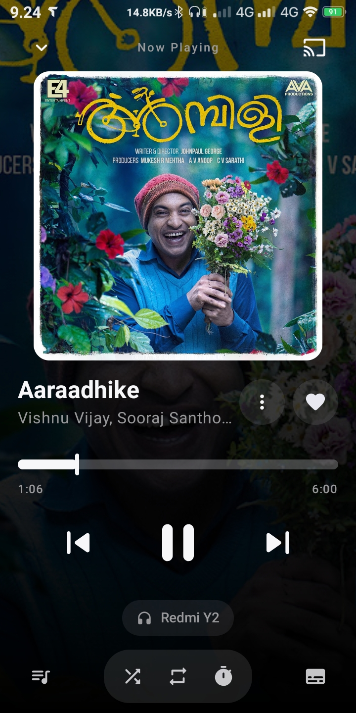
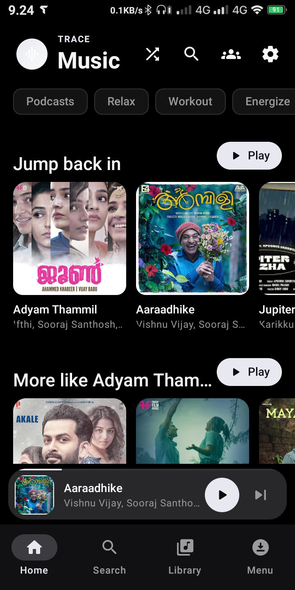
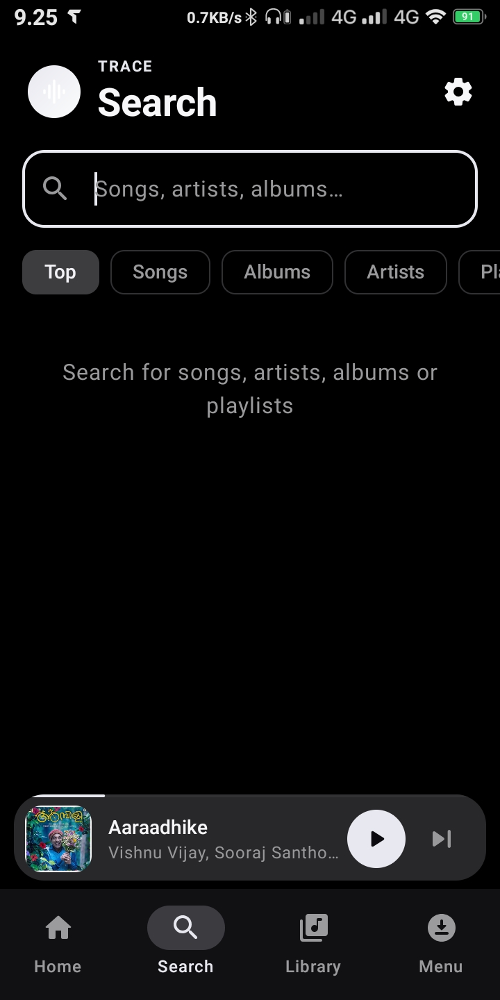
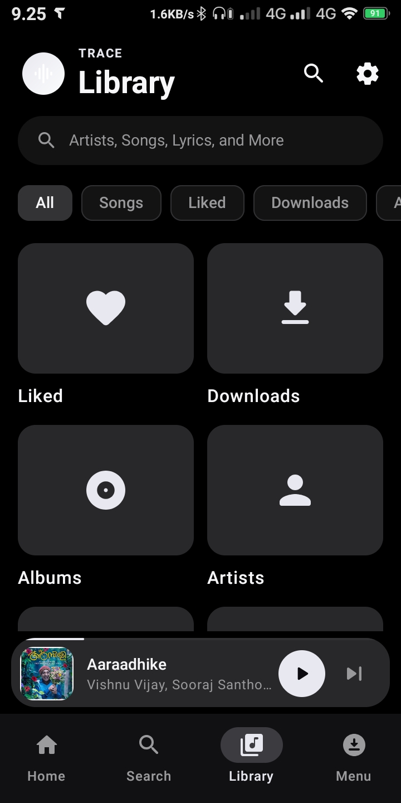
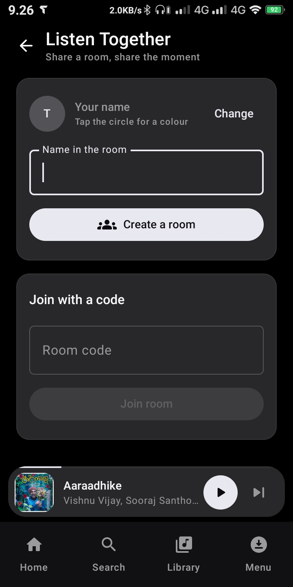
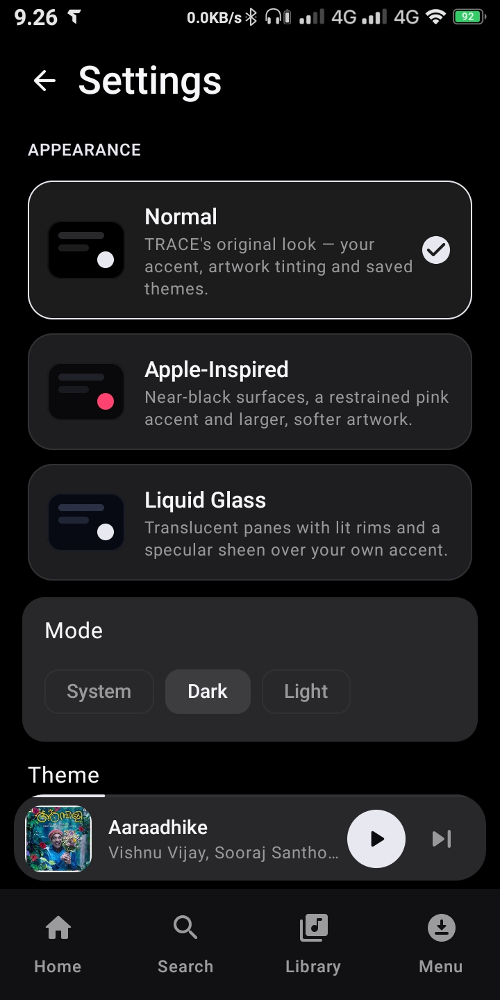

# TRACE

### Cinematic music, quietly.

  
  
  

<i>A dark-first Android music player built around artwork, atmosphere, and effortless playback.</i>

  <a href="#-features">Features</a> ·
  <a href="#-screenshots">Screenshots</a> ·
  <a href="#-architecture">Architecture</a> ·
  <a href="#-building">Building</a> ·
  <a href="#-license--guidelines">License</a>

## 🎵 About TRACE

TRACE is a focused, cinematic music player for Android. It combines music discovery and streaming with Media3/ExoPlayer playback, background controls, persistent queues, and a redesigned dark-first interface centered on artwork and typography.

Search real music, stream it ad-free, share a room and listen together, build playlists, and let the interface adapt to the artwork of whatever is playing.

## 🛡️ Privacy-First by Design

Completely local database. Absolutely zero trackers, analytics, or background
telemetry. Temporary stream URLs are never persisted.

## 🎨 Theme Studio

Twelve ready themes plus a builder that hands over the four colours every look is
made of — accent, background, surface, text — with full hue/saturation/lightness
control, live preview and locally stored custom themes. Three appearances on top:
**Normal**, **Apple-Inspired** and **Liquid Glass**.

## 🚀 Ad-Free Streaming

Seamless background playback with high-fidelity streams from YouTube Music.

---

## 📸 Screenshots

### 🎧 Now Playing

### 🏠 Home

### 🔍 Search

### 🎵 Library

### 🤝 Listen Together

### ⚙️ Settings

---

## ✨ Features

### 🎨 Expressive UI & Design

- **Dark-first, cinematic.** A calm surface that puts artwork and typography first.
- **Three appearances.** Normal, Apple-Inspired (near-black / warm-white surfaces,
  restrained red/pink accent, larger artwork, softer corners) and Liquid Glass
  (translucent panes with a diagonal specular sheen and a lit gradient rim). All
  three are a single design-token swap — playback never restarts.
- **Theme studio.** Twelve ready themes plus a builder with full HSL control,
  live preview and locally stored custom themes.
- **Swipe between tabs.** Home, Search, Library and Menu are pages of a pager.
- **Swipe the player.** Swipe the artwork or the mini-player bar left/right to skip.
- **Swipe shortcuts.** Swipe a song row right to play it next, left to queue it.
- **Grouped lists.** Library leads with a search pill, filter chips and big tiles;
  Settings is a stack of raised cards.

### 🎵 Advanced Streaming

- **Full catalog.** Stream any song from YouTube Music, completely ad-free.
- **Background playback.** High-quality continuous playback with full notification
  drawer and lock-screen controls.
- **Extreme audio quality.** Beyond High: highest-bitrate format, highest-supported
  bitrate pinned, float PCM sink, offload off. Honestly labelled — YouTube Music's
  ceiling is ~256 kbps AAC.
- **Resilient streaming.** Stream URLs are resolved lazily right before playback
  and re-resolved on expiry without restarting the queue.

### 🎧 Listen Together

- **Create a room, share the code.** Everyone hears the same track at the same
  second: the host's play/pause, skips and seeks are broadcast, guests follow, and
  a five-second position beat corrects drift.
- **Room chat.** Text, voice notes and photos — all carried through the same
  string channel with a tiny self-describing envelope.
- **Privacy-preserving.** Only metadata (title, artist, duration, artwork URL) is
  sent; every device resolves its own audio. No stream URL is ever shared.
- **Rooms close when everyone leaves.** Nothing is stored on the server.

### 📝 Playlists

- **Playlists that actually create.** "New playlist" writes the playlist row
  before its first song, which is what the foreign key demands.
- **Songs stay.** Adding a track you've never played still works — the song row is
  written first.

### 🔍 Search

- **Search that keeps up with you.** Results are fetched while you type
  (debounced, last-write-wins). Only submitted queries are saved to "Recent".

### 📥 Offline Experience

- **Menu — offline.** A fourth tab listing everything playable with no network:
  songs kept in the player cache plus anything downloaded. Badges say which is
  which, and the header reports real bytes on disk.

### 🔄 OTA Updater

- **Seamless updates.** Point TRACE at a JSON release feed and it checks once per
  launch: a notification plus a changelog dialog, then one tap hands the download
  to Android's installer. Nothing is fetched when the feed URL is left blank. See
  [`docs/UPDATES.md`](docs/UPDATES.md).

### 🛡️ 100% Privacy

- **Zero data collection.** No trackers, no telemetry, no analytics.
- **Local security.** All libraries, preferences and cached tracks are stored
  locally in Room.

---

## 🚗 Android Auto Setup

If TRACE doesn't appear in Android Auto:

1. Open Android Auto on your phone
2. Tap the hamburger menu (three lines) and go to Settings
3. Scroll to the bottom and tap the version number multiple times to enable
   Developer Settings
4. Tap the three dots menu (⋮) at the top-right
5. Select Developer settings
6. Enable Unknown sources
7. Restart Android Auto and connect to your car

---

## 🤝 Contributing

Contributions are welcome! Whether it's bug reports, feature requests, or code
contributions:

1. Fork the repository
2. Create your feature branch (`git checkout -b feature/AmazingFeature`)
3. Commit your changes (`git commit -m 'Add some AmazingFeature'`)
4. Push to the branch (`git push origin feature/AmazingFeature`)
5. Open a Pull Request

---

## 🛡️ Privacy & Data Collection

At TRACE, your privacy is our top priority. We believe that your music and data
belong exclusively to you.

- **Zero Data Collection:** We do not collect, store, or share any of your
  personal information, usage habits, or listening history.
- **100% Local:** All your settings, downloaded tracks and offline caches are
  stored securely on your device.
- **No Tracking:** There are no hidden trackers, analytics, or background services
  monitoring your activity.

Enjoy your music with complete peace of mind, knowing that your privacy is fully
protected.

---

## 📜 Disclaimer

This project and its contents are not affiliated with, funded, authorized,
endorsed by, or in any way associated with YouTube, Google LLC, or any of their
affiliates and subsidiaries.

Any trademark, service mark, trade name, or other intellectual property rights
used in this project are owned by their respective owners.

TRACE is an independent project created for educational and personal use purposes.

---

## 📄 License & Guidelines

This project is licensed under the terms specified in the
[LICENSE](LICENSE) file (GPL-3.0).

TRACE incorporates and adapts open-source components and preserves applicable upstream notices.
See [`THIRD_PARTY_LICENSES.md`](THIRD_PARTY_LICENSES.md) for the complete list, or
open **Settings → Open-source licences** inside the app.

Proprietary upstream modules (Musixmatch, JioSaavn, Kizzy/Discord RPC) are **not**
included.

If you copy, adapt, or reuse any part of the source code, you must adhere to the
guidelines outlined in [`rules.md`](rules.md).

---

## 🌐 Community & Support

| Channel | About | Action |
|---|---|---|
| 🐛 Bug Reports | Found something broken? Open a GitHub issue | [Report Bug](https://github.com/tracezer/Trace/issues) |
| 💡 Discussions | Share ideas, request features | [Discussions](https://github.com/tracezer/Trace/discussions) |
| 📖 Docs | Listen Together, updates, architecture | [`docs/`](docs/) |

---

## 🙏 Special Thanks & Credits

TRACE is built upon the foundation of amazing open-source projects and developers:

- **Open-source music tooling** — for discovery, stream resolution, and playback foundations.
- **Metrolist** — the project that inspired upstream music project.
- **InnerTube / NewPipeExtractor** — discovery and stream resolution.
- **Media3 / ExoPlayer** — playback.
- **Jetpack Compose & Material 3** — the UI toolkit.

Thank you to all the amazing developers who made this project possible!

---

Made with ❤️ for music lovers everywhere

⭐ Star this repo if you enjoy TRACE!
